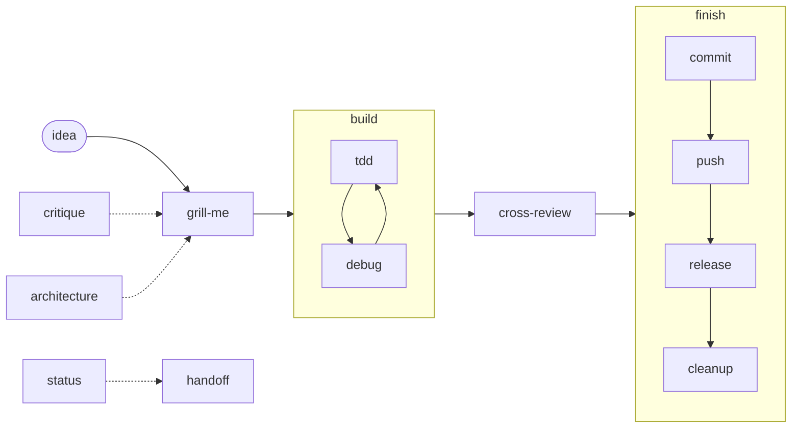

# mastack

A small skill pack for coding agents (Claude Code, Codex) that already know how
to code. Each skill is a process with a trigger: when to use it, what matters,
what comes out. Nothing a strong model does unprompted; every rule that is here
earned its place, many of them through an incident.

The thinking skills distil ideas from Matt Pocock's skills. The shipping skills
encode a solo developer's flow: many agents in one working tree, a promote tool
that owns the main branches, CI followed to the end.

## Flow



- **Think**: `grill-me` turns an idea into decisions, one question at a time.
  `critique` gives a verdict instead of doing the work. `architecture` finds
  shallow modules and designs deeper ones; a candidate it finds goes back into
  `grill-me`.
- **Build**: `tdd` for checkable behavior, `debug` when something is broken.
  A bug without a good seam for its test is an `architecture` finding.
- **Check**: `cross-review` by a model of another family, one round of fixes.
- **Ship**: `finish` runs `commit`, `push`, `release` and `cleanup` in order,
  each under its own rules, and reports risk and what is unverified.
- **Between sessions**: `status` shows what runs and what waits for you;
  `handoff` pauses cleanly for the next agent.

## Skills

| Skill | Use it for |
|---|---|
| [grill-me](skills/grill-me/SKILL.md) | Settling a plan by interview; glossary and ADRs as you go |
| [critique](skills/critique/SKILL.md) | "What do you think?": judgment, no execution |
| [architecture](skills/architecture/SKILL.md) | Finding shallow modules, designing an interface twice |
| [tdd](skills/tdd/SKILL.md) | Red-green slices at public seams |
| [debug](skills/debug/SKILL.md) | Reproduce first, falsifiable hypotheses, fix the class |
| [cross-review](skills/cross-review/SKILL.md) | Blind two-axis review by another model family |
| [commit](skills/commit/SKILL.md) | Committing a task's work in a shared tree |
| [push](skills/push/SKILL.md) | Publishing the chain by SHA, CI to a final result |
| [release](skills/release/SKILL.md) | Cutting a version late, publishing from a clean checkout |
| [finish](skills/finish/SKILL.md) | The whole chain in one request, with a risk report |
| [cleanup](skills/cleanup/SKILL.md) | Merged branches, worktrees, stray processes |
| [status](skills/status/SKILL.md) | What runs, what waits for you, what is blocked |
| [handoff](skills/handoff/SKILL.md) | A clean pause and a handoff file |

Every skill can be invoked by the model, so a request in your own words
("пуш", "что в работе?") reaches it. Descriptions carry trigger phrases in the
languages the author works in; add yours.

## Conventions

- **Facts live in the project.** Skills read `docs/agents/*.md` at fixed paths:
  how to publish, which checks to run, where the glossary is, how the tracker
  works. See [CONTRACT.md](CONTRACT.md). A missing file is reported, not guessed.
- **Models live in one table.** [models.toml](models.toml) maps roles to models,
  effort and fallbacks; [models.md](models.md) says why.
- **Tools over prose.** Anything a machine can check belongs in a hook or tool,
  such as a promote tool that owns the main branches or `slotfather`, a queue
  of machine slots for heavy checks.
  A skill names the tool; it does not retell it.
- **One layer per fact.** A rule lives in one place: a skill, the model table,
  global agent rules, a tool, or the project's docs.

## Install

```sh
git clone https://github.com/maxvyshniakov/mastack ~/mastack
~/mastack/bin/install            # symlink every skill into ~/.claude/skills and ~/.agents/skills
~/mastack/bin/install --dry-run  # show what it would do
~/mastack/bin/install --uninstall
```

Links point at the checkout, so `git pull` updates every agent at once. An
existing skill directory with the same name is left alone and reported.

Before installing:

- `push`, `release` and `finish` follow `docs/agents/publishing.md`. Give each
  project you use them in that file first; without it they can only push to the
  branch's upstream, which skips whatever the project's own push flow does.
- `critique` replaces a standalone "what do you think" skill or global rule.
  Remove those yourself (for example `what-do-you-think` in the skill
  directories and the matching rule in your global agent instructions) so two
  instructions do not compete.

## Develop

- `bin/check` scans the tree for private details: IP addresses, home paths,
  e-mail addresses, issue references, tokens, plus your own patterns from
  `~/.config/mastack/private-patterns` (one regular expression per line, kept
  out of the repository). `bin/check --history` scans every commit.
  `.githooks/pre-push` runs it; enable with `git config core.hooksPath .githooks`.
- `bin/eval <skill> [scenario]` runs a scenario from `evals/` against a scratch
  repository and grades what the agent did. See [evals/README.md](evals/README.md).
- After a new model ships: run the evals, then reread each skill and delete any
  line the model would follow without being told.

## License

MIT. See [LICENSE](LICENSE). Ideas in `grill-me`, `architecture`, `tdd`, `debug`
and `cross-review` come from [Matt Pocock's skills](https://github.com/mattpocock/skills),
also MIT; the texts here are rewritten, and his notice is kept in LICENSE.
