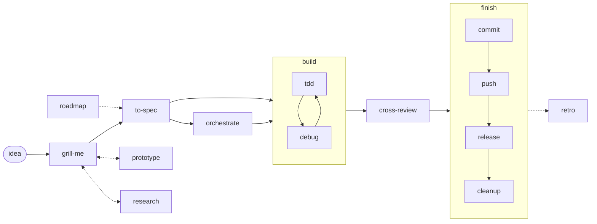

# mastack

A small skill pack for coding agents (Claude Code, Codex) that already know how
to code. Each skill is a process with a trigger: when to use it, what matters,
what comes out. Nothing a strong model does unprompted; every rule that is here
earned its place, many of them through an incident.

The thinking skills distil ideas from [Matt Pocock's skills](https://github.com/mattpocock/skills).
The shipping skills encode a solo developer's flow: many agents in one working
tree, a promote tool that owns the main branches, CI followed to the end. A set
of Bash hooks for Claude Code turns the mechanical rules into checks.

**Status.** This is one developer's daily setup, published as it is. It runs
on macOS with Claude Code and Codex. Versions are Git tags with a
[changelog](CHANGELOG.md); there is no support promise, and a rule changes when
an incident shows it was wrong. Take what fits, adapt the rest.

## Ideas behind it

- **A skill is a process, not knowledge.** The model already knows Git, testing
  and review. A skill says when to start, what to check, what to report, and
  what never to do; the no-op test removes any line a strong model would follow
  without being told.
- **Facts live in the project.** Skills read a few files at fixed paths
  (`docs/agents/*.md`, see [CONTRACT.md](CONTRACT.md)), so one skill works in
  many repositories. A missing file is reported, not guessed.
- **Tools over prose.** What a machine can check belongs in a hook, a test or a
  tool, such as a promote tool that owns the main branches or
  [Slotfather](https://github.com/maxvyshniakov/slotfather), a queue of machine
  slots for heavy checks. A skill names the tool; it does not retell it.
- **Another model family reviews.** Implementation and review run on models of
  different families, chosen from one table ([models.toml](models.toml)).
- **One layer per fact.** A rule lives in one place: a skill, the model table,
  global agent rules, a tool, or the project's docs.

## Flow



- **Think**: `grill-me` turns an idea into decisions, one question at a time;
  `prototype` and `research` answer the questions talk cannot. `critique` gives
  a verdict instead of doing the work. Work bigger than one session starts in
  `roadmap`, a map of decisions, and joins at `to-spec`.
- **Plan**: `to-spec` writes the spec and slices it into tickets whose briefs
  are contracts.
- **Build**: `orchestrate` runs tickets in parallel lanes; each lane, or a
  single session, builds with `tdd` and `debug`. A bug without a good seam for
  its test is an `architecture` finding.
- **Check**: `cross-review` by a model of another family, one round of fixes.
  `browser-verify` proves a screen in Chromium, Firefox, WebKit and Safari.
  `rate` scores anything against a fixed rubric and improves it to 10.
- **Ship**: `finish` runs `commit`, `push`, `release` and `cleanup` in order,
  each under its own rules, and reports risk and what is unverified.
- **Keep the environment good**: `retro` after a session that went wrong,
  `agent-docs` for what agents read, `friction-audit` for what keeps confusing
  agents in a package, `deps-update` to update pins and retire workarounds.
- **Between sessions**: `status` shows what runs and what waits for you;
  `handoff` pauses cleanly for the next agent.

## Skills

| Skill | Use it for |
|---|---|
| [grill-me](skills/grill-me/SKILL.md) | Settling a plan by interview; glossary and ADRs as you go |
| [critique](skills/critique/SKILL.md) | "What do you think?": judgment, no execution |
| [roadmap](skills/roadmap/SKILL.md) | A map of decision tickets for work bigger than one session |
| [prototype](skills/prototype/SKILL.md) | Throwaway code that answers one design question |
| [research](skills/research/SKILL.md) | A background agent, primary sources, one cited file |
| [to-spec](skills/to-spec/SKILL.md) | The agreed design as a spec and contract tickets |
| [architecture](skills/architecture/SKILL.md) | Finding shallow modules, designing an interface twice |
| [orchestrate](skills/orchestrate/SKILL.md) | Parallel lanes, blind review, one gate per batch |
| [tdd](skills/tdd/SKILL.md) | Red-green slices at public seams |
| [debug](skills/debug/SKILL.md) | Reproduce first, falsifiable hypotheses, fix the class |
| [cross-review](skills/cross-review/SKILL.md) | Blind two-axis review by another model family |
| [browser-verify](skills/browser-verify/SKILL.md) | A UI change proven in every engine, off the owner's screen |
| [rate](skills/rate/SKILL.md) | A fixed rubric, fixes, a blind re-score until 10/10 |
| [commit](skills/commit/SKILL.md) | Committing a task's work in a shared tree |
| [push](skills/push/SKILL.md) | Publishing the chain by SHA, CI to a final result |
| [release](skills/release/SKILL.md) | Cutting a version late, publishing from a clean checkout |
| [finish](skills/finish/SKILL.md) | The whole chain in one request, with a risk report |
| [cleanup](skills/cleanup/SKILL.md) | Merged branches, worktrees, stray processes |
| [deps-update](skills/deps-update/SKILL.md) | Updating every pin, then retiring fixed workarounds |
| [status](skills/status/SKILL.md) | What runs, what waits for you, what is blocked |
| [handoff](skills/handoff/SKILL.md) | A clean pause and a handoff file |
| [retro](skills/retro/SKILL.md) | Fixing the environment after a session went wrong |
| [agent-docs](skills/agent-docs/SKILL.md) | Writing and auditing what agents read |
| [friction-audit](skills/friction-audit/SKILL.md) | What confuses agents in a package, and the layer that fixes it |
| [video-feedback](skills/video-feedback/SKILL.md) | Recorded feedback to timestamped, verified requirements |
| [reprompt](skills/reprompt/SKILL.md) | Deepening a task, then rewriting the prompt (user-invoked) |

Every skill except `reprompt` can be invoked by the model, so a request in your
own words, in any language, reaches it. A description says when to use the
skill, in English: the model matches requests against it, so keep it short.

## Requirements

- Claude Code, Codex CLI, or both. Skills are plain `SKILL.md` folders; the
  hooks are for Claude Code.
- macOS or Linux with Git, Bash and Python 3.11 or newer. The hooks and the
  installer are developed and tested on macOS.
- `gh`, signed in, for the skills that read or write GitHub issues, pull
  requests and CI (`push`, `status`, `orchestrate`, `cross-review`).
- Optional: [Slotfather](https://github.com/maxvyshniakov/slotfather) for the
  lease guard and machine slots; a lane tool for `orchestrate` (the author uses
  Lanefather, not public yet; without one the skill uses worktrees, branches
  and `gh`); `ffmpeg` and a local Whisper for `video-feedback`; Playwright and
  Safari Technology Preview for `browser-verify`.

## Install

```sh
git clone https://github.com/maxvyshniakov/mastack ~/mastack
~/mastack/bin/install --dry-run                    # show what it would do
~/mastack/bin/install --skip push,release,finish   # symlink the rest into ~/.claude/skills and ~/.agents/skills
~/mastack/bin/install --only push                  # add one later
~/mastack/bin/install --uninstall --only push      # remove one; without --only/--skip, all
```

`~/.claude/skills` is where Claude Code reads user skills and
`~/.agents/skills` where Codex does; `--target DIR` picks other directories.
Links point at the checkout, so `git pull` updates every agent at once. An
existing entry with the same name in the user skill directories is left alone
and reported. Without `--skip hooks`, install also registers the Bash hook,
which needs its settings file first (see [Hooks](#hooks)); `--skip hooks`
installs skills only.

A user-level skill beats a project skill of the same name in Claude Code, and
Codex shows both (see [CONTRACT.md](CONTRACT.md#skills-with-a-pack-skills-name)).
So the installer reads, without changing them, every Git repository directly
under `~` (`$MASTACK_SCAN_ROOT` to look elsewhere), plus any `--project DIR`
and the directories listed in `~/.config/mastack/projects`, and holds back any
pack skill a project also has in `.claude/skills` or `.agents/skills`.
Worktrees are marked as copies of their repository:

```
shadow push: ~/app/.claude/skills/push (project has docs/agents/publishing.md)
shadow push: ~/app-wt-2/.claude/skills/push (copy: worktree of ~/app)
```

Remove the project's copy first, then install the pack skill; `--force`
installs it anyway. Repositories listed in `~/.config/mastack/ignore` (same
format; frozen or archived ones) are not checked, nor are their worktrees.
`$MASTACK_CONFIG` moves `~/.config/mastack`.

Before installing:

- `push`, `release` and `finish` follow `docs/agents/publishing.md`. Give each
  project you use them in that file first; without it they can only push to the
  branch's upstream, which skips whatever the project's own push flow does.
- `critique` replaces a standalone "what do you think" skill or global rule.
  Remove those yourself (for example `what-do-you-think` in the skill
  directories and the matching rule in your global agent instructions) so two
  instructions do not compete.

### Adopting part of it

- **A few skills.** `--only` picks them. These work in any repository without
  project files: `critique`, `grill-me`, `prototype`, `research`, `tdd`,
  `debug`, `rate`, `handoff`, `retro`, `agent-docs`, `video-feedback`,
  `reprompt`. The shipping skills (`commit`, `push`, `release`, `finish`,
  `cleanup`, `orchestrate`, `status`) pay off once the project has the
  [contract files](#project-contract).
- **Without the installer.** Copy a skill's folder into a project's
  `.claude/skills/` or `.agents/skills/`. Keep the `agents/openai.yaml` beside
  `SKILL.md`; Codex reads its display name and invocation policy.
- **Hooks only.** `bin/install --only hooks`, or run one check alone as a
  hook: each `hooks/<check>.py` reads Claude Code's hook JSON on stdin.

## Project contract

[CONTRACT.md](CONTRACT.md) lists the files a project keeps under
`docs/agents/` and which skills read each: `publishing.md` (branches, the push
command, CI, releases), `checks.md` (focused and full checks, heavy-check
wrapper, review rules), `domain.md` (glossary and ADRs), `issue-tracker.md`,
`orchestration.md` (lane tool, report labels, owner queue) and `hooks.json`
(the project's own mutating steps for the hook). Each file has a template
there; a section the project leaves out means the skill's default. This
repository's own [docs/agents/](docs/agents/) is a small example.

## Models

[models.toml](models.toml) maps roles (design, implement, visual, review,
routine, research, audit) to an ordered list of models with effort and
conditions, for example "a reviewer of another family than the implementer,
while at least 15% of the weekly Codex quota is left". Skills that start
another model (`cross-review`, `orchestrate`) and tools read it; `[cli.*]`
gives the headless command for each CLI. [models.md](models.md) gives the
reasons. The model ids are the author's; edit the table, not the skills, to
use yours.

## Hooks

`bin/install` also registers one Claude Code `PreToolUse` hook for the Bash
tool in `~/.claude/settings.json`: `hooks/bash_guard.py`, which runs every
check below in one process and imports a check only when the command holds
the text it looks for. Each check is a module of its own and runs alone as a
hook too; its docstring defines exactly what it denies.

| Check | Denies |
|---|---|
| `git_guard` | a mutating git step piped into a filter mid-chain; pushing `main`, `dev` or `HEAD` by name in a shared checkout's repository; force pushes and `--no-verify`; discarding work in a shared checkout; untagged or implicit stash use |
| `unguarded_sequence` | a mutating step (git merge, push, commit ..., `gh pr merge`, `gh issue close`, Lanefather lane/ref mutations, and the project's own steps) after `;` or a newline whose earlier step may have failed |
| `zsh_word_split` | an unquoted scalar `$var` that zsh, the Bash tool's shell, passes as one word where bash splits it |
| `pgrep_self_match` | a `pgrep -f` that waits (an if, while or until condition, a loop body) or a `pkill -f` anywhere, whose literal pattern matches its own command, so it finds every agent shell running that text (a wait loop never ends) |
| `lease_guard` | a `kill`, `pkill` or `killall` that reaches a process inside another holder's `slotfather` lease; passes when slotfather is absent |
| `shell_pitfalls` | GNU-only forms that fail on macOS: GNU `timeout`, GNU cat's show-all flag |

A deny from any check wins and names each check that denied. Every check
fails open: unreadable input, configuration or project files let the command
run, and a check that crashes is logged to `guard.log` and skipped. The
parsers run first; the lease guard runs last and only while nothing is
denied, and all of them share a time budget below the hook's timeout, so a
slow `slotfather` cannot let the timeout drop a deny already found.

- **Machine settings**, `~/.config/mastack/hooks.json` (`$MASTACK_CONFIG`
  moves the directory), outside the repository: `checkouts` (shared main
  checkouts, where `push-by-name` and `shared-checkout` apply), `state_dir`
  (for `guard.log`), `lane_records` (the lane tool's records, for the lease
  guard), `mutating_steps` (extra steps for every project, added to the
  project's own) and `slotfather` (its path, when it is not on `PATH`). Start
  from `hooks/hooks.example.json`; `bin/install` refuses to register the hook
  while the file is missing. `{}` is a valid start; the checkout rules
  (`push-by-name`, `shared-checkout`) then protect nothing and the lease guard
  knows no lanes.

  ```json
  { "checkouts": ["~/code/app"] }
  ```
- **Project steps**, `docs/agents/hooks.json` in the session's repository
  (see [CONTRACT.md](CONTRACT.md#docsagentshooksjson)).
- **Overrides** are the owner's: a command starting `GIT_GUARD_OK="<reason>"`
  passes git_guard; `LEASE_GUARD_OK="<reason>"` turns a lease deny into a
  permission prompt. Both are logged.
- **Install** from the main checkout (a worktree's path disappears with it,
  so it is refused): `bin/install --only hooks` registers just the hook,
  `--skip hooks` leaves the settings alone, `--dry-run` prints the diff, and
  `--uninstall --only hooks` removes only mastack's entries. The registered
  command runs `bash_guard.py` through `sh` and lets commands through if the
  file is gone. In Bash groups, install replaces the per-check entries of the
  author's earlier layout (an `agent-hooks` directory and
  `~/.claude/hooks/macos-shell-pitfalls.sh`; absent elsewhere) and the
  commands earlier installs recorded in
  `~/.config/mastack/hooks-installed.json`; it keeps every other entry,
  writes `settings.json.mastack-backup-<time>` first, follows a symlinked
  settings file, and starts over if Claude Code wrote the file meanwhile.
- **What runs.** The checks parse the command text; they never run it. To
  decide, `git_guard` runs `git rev-parse` in the directories the command
  names, and `lease_guard` (only for commands with `kill`) runs
  `slotfather status`, `ps`, and the read-only producer the command itself
  names (`pgrep`, `lsof -t`, or reading the pid file of `cat FILE`). Nothing
  goes over the network. They write only `guard.log` in the state directory
  (default `$XDG_STATE_HOME/mastack`). The
  hooks catch an agent's mistakes; they are not a sandbox, and an agent can
  get around them, for example through a script file.
- **Codex** (0.165) has `PreToolUse` hooks with the same JSON contract
  (`hooks` feature, `hooks.json` or `[hooks]` in `config.toml`), but each
  hook must be trusted in `/hooks` before it runs, and its shell tool's
  matcher name could not be confirmed, so `bin/install` does not register
  there yet. To try it by hand, add the same group to `~/.codex/hooks.json`
  with the matcher Codex reports for its shell tool, then trust it in `/hooks`.

## Evals

`evals/<skill>/*.md` are scenarios: a prompt, a setup that builds a scratch
repository, and a grade that checks what the agent left behind.

```sh
bin/eval --list
bin/eval push --agent none   # no agent: every grade must fail, which checks the scenarios
bin/eval push                # real Claude sessions (default model: opus in models.toml)
bin/eval push --agent codex  # the same with Codex
```

A real run starts agent sessions and spends tokens. Some prompts are
deliberately in Russian, to check that a skill triggers from a request in
another language. See [evals/README.md](evals/README.md).

## Develop

- `bin/check` scans the tree for private details: IP addresses, home paths,
  e-mail addresses, issue references, tokens, plus your own patterns from
  `~/.config/mastack/private-patterns` (one regular expression per line, kept
  out of the repository). `bin/check --history` scans every commit. Without
  `--history` it then runs the tests (`*_test.sh`, `*_test.py`), among them
  `tests/hooks_test.py`, which replays `hooks/fixtures/` against each check
  and through the dispatcher.
  `.githooks/pre-push` runs it; enable with `git config core.hooksPath .githooks`.
  CI runs the same on every push and pull request.
- After a new model ships: run the evals, then reread each skill and delete any
  line the model would follow without being told.
- [CONTRIBUTING.md](CONTRIBUTING.md) says what a change needs;
  [SECURITY.md](SECURITY.md) how to report a problem and what the hooks run.

## License

MIT. See [LICENSE](LICENSE). Ideas in `grill-me`, `roadmap`, `prototype`,
`research`, `to-spec`, `orchestrate`, `architecture`, `tdd`, `debug`,
`cross-review`, `agent-docs` and `retro` come from [Matt Pocock's skills](https://github.com/mattpocock/skills),
also MIT; the texts here are rewritten, and his notice is in
[THIRD_PARTY_NOTICES.md](THIRD_PARTY_NOTICES.md) with the tools the pack runs
but does not ship.
