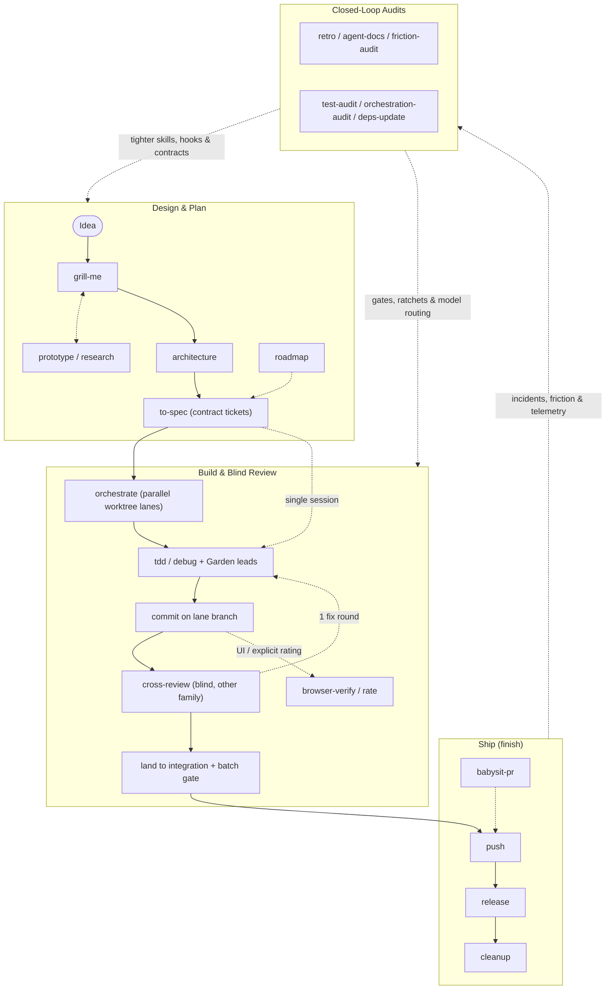

# mastack

A concise skill pack, model router, and mechanical hook suite for coding agents
(Claude Code, Codex CLI, Antigravity / T3 Code) that already know how to code.
Each skill is a process with a trigger: when to start, what to check, what to
report, and what never to do. Every rule earned its place — many of them
through an incident.

The design and thinking skills distil and sharpen ideas from
[Matt Pocock's skills](https://github.com/mattpocock/skills). The delivery and
shipping skills encode a disciplined multi-agent workflow: **one worktree per
agent**, blind cross-family review, a promote tool that owns the main branches,
and CI followed to a final result. A set of Bash and lifecycle hooks turns
mechanical rules into hard checks instead of hoping a model remembers prose.

**Status.** One developer's daily setup, published as-is. Runs on **macOS and
Linux** with Claude Code, Codex CLI, and Antigravity / T3 Code (Safari checks in
`browser-verify` are macOS-only). Development happens on `main`; tagged releases
carry a [changelog](CHANGELOG.md). There is no support promise — a rule changes
when an incident proves it wrong. Take what fits, adapt the rest.

## Why mastack

- **Built for strong modern models — zero hand-holding.** Lines are pruned by
  the *no-op test* ("would a strong model do this without being told?"), backed
  by scenario evals (6 skills, runnable with `--without-skill`). No textbook
  "what is Red-Green-Refactor" filler: `tdd` goes straight to public seams,
  independent expected values, the cheapest layer (`model` / `render` /
  `browser` / `process`), zero sleeps, and non-tautological assertions.
- **Warm-context "Garden" leads (~10–20% extra output, high leverage).** Standard
  agent loops wear blinders: implementers build strictly to spec, reviewers check
  strictly against spec. Here, both implementers (`Garden`, `Least sure`) and
  reviewers (`Part 2: Follow-ups` — repeating defect classes, symmetry gaps,
  wrong-layer patches) surface systemic problems while their context is already
  warm, structured as `Proof / Direction / Verify` so the next agent starts warm.
- **Blind cross-family review with falsifiers and no patch code.** Another model
  family reviews blind (`models.toml` + `bin/role` reading live quotas). Every
  finding carries a concrete **falsifier** (run first as a failing test; if it
  passes, auto-reject) and **fix direction without patch code** (preventing
  symptom-anchoring), capped at one fix round per lane.
- **Architecture and design core (distilled from Matt Pocock's skills).**
  `grill-me` settles one decision at a time with a recommendation while updating
  the live domain glossary and ADRs; `architecture` (deep modules,
  seams/adapters, deletion test, explicit state machines, *design it twice*)
  draws clear module boundaries and testable seams; `to-spec` emits contract
  tickets; `prototype` tests UI ideas as real-page `?variant=` variants.
- **Closed-loop audits that keep the system sharp.** `retro` ("prove it bites",
  promoting recurring Judgment findings to Mechanical checks), `agent-docs`
  (keeping prompts lean and non-contradictory), `test-audit` (`runs × time`
  cost, web-UI blindspots, ratchets over noisy warnings), `friction-audit`,
  `orchestration-audit` (token burn, review yield, `Garden yield`), and
  `deps-update` (forward pass + back pass retiring fixed `UPSTREAM(...)`
  workarounds).
- **Concise, reusable, deterministic where an LLM isn't needed.**
  [CONTRACT.md](CONTRACT.md) separates portable process from repo facts
  (`docs/agents/*.md`), so one skill pack works across repositories without
  guessing. Deterministic CLIs (`bin/role`, `bin/lane-receipt`, `bin/quiet-cap`,
  `bin/check`, `bin/sync-docs`) and Bash/lifecycle hooks (`unguarded_sequence`,
  `pgrep_self_match`, `release_guard`, `lease_guard`, `codex_credits`) enforce
  rules mechanically instead of relying on prose.

## Companion suite: `fathers`

Non-obvious rules in `mastack` carry a one-line reason so future edits do not
drop incident guards. For execution mechanics, guarded process teardown, and
historical telemetry, pair `mastack` with the public
[`fathers`](https://github.com/maxvyshniakov/fathers) CLI suite
(standard-library Python 3.11+, macOS and Linux):

| Tool | Role alongside `mastack` |
|---|---|
| [`slotfather`](https://github.com/maxvyshniakov/fathers/tree/main/slotfather) | Machine capacity queue and leases for heavy checks (`lease_guard`, `slot_label`) |
| [`lanefather`](https://github.com/maxvyshniakov/fathers/tree/main/lanefather) | Worktree lanes, path claims, integration, review state, and `lanefather stats` |
| [`spawnfather`](https://github.com/maxvyshniakov/fathers/tree/main/spawnfather) | Owned lifetimes and guarded teardown for long-lived processes and worktrees (supersedes `junkfather`; `mastack` hooks recognize both names) |
| [`tokenfather`](https://github.com/maxvyshniakov/fathers/tree/main/tokenfather) | Multi-provider token usage and lane-attributed history for `orchestration-audit` |
| [`godfather`](https://github.com/maxvyshniakov/fathers/tree/main/godfather) | Unified terminal dashboard across the suite |

**`fathers` is public and optional.** Delivery and shipping skills degrade
cleanly without it, falling back to plain Git worktrees, branches, and `gh`
(`orchestration-audit` is the one skill that directly reads `tokenfather` and
`lanefather stats`).

## Flow



- **Design & Plan**: `grill-me` settles an idea one question at a time with
  recommendations, updating the glossary and ADRs; `prototype` and `research`
  answer questions talk cannot; `critique` gives a verdict (or cross-family
  council) without executing. Multi-session work starts in `roadmap` (a map of
  decision tickets), checks boundaries with `architecture`, and joins at
  `to-spec` to produce contract tickets.
- **Build & Check**: `orchestrate` runs tickets in parallel worktree lanes (or a
  single session runs `tdd` and `debug` directly), emitting warm-context
  `Garden` leads alongside the diff. A bug with no clean seam is an
  `architecture` finding. `cross-review` checks blind with another model family
  and allows one fix round; `browser-verify` proves UI across Chromium, Firefox,
  WebKit, and Safari; `rate` drives work to 10/10 against a fixed rubric with
  blind re-scoring.
- **Ship**: `finish` chains `commit`, `push`, `release`, and `cleanup` in order,
  stopping on first failure and reporting risk and what stays unverified.
  `babysit-pr` takes an open pull request through checks and review threads.
- **Closed-Loop Audits**: `retro` after a rough session, `agent-docs` for prompt
  hygiene, `friction-audit` for package misuse, `test-audit` for suite cost and
  blindspots, `orchestration-audit` for token burn and review/`Garden` yield,
  and `deps-update` to move pins and retire fixed workarounds.
- **Between sessions**: `status` reports what runs, blocks, or waits for you;
  `handoff` writes a clean pause file for the next agent.

## Skills

| Skill | Use it for |
|---|---|
| [grill-me](skills/grill-me/SKILL.md) | Settling a plan by interview; glossary and ADRs as you go |
| [critique](skills/critique/SKILL.md) | "What do you think?": judgment, no execution |
| [roadmap](skills/roadmap/SKILL.md) | A map of decision tickets for work bigger than one session |
| [prototype](skills/prototype/SKILL.md) | Throwaway code that answers one design question |
| [research](skills/research/SKILL.md) | A background agent, primary sources, one cited file |
| [to-spec](skills/to-spec/SKILL.md) | The agreed design as a spec and contract tickets |
| [architecture](skills/architecture/SKILL.md) | Finding shallow modules, designing an interface twice |
| [orchestrate](skills/orchestrate/SKILL.md) | Parallel lanes, blind review, one gate per batch |
| [tdd](skills/tdd/SKILL.md) | Red-green slices at public seams |
| [debug](skills/debug/SKILL.md) | Reproduce first, falsifiable hypotheses, fix the class |
| [cross-review](skills/cross-review/SKILL.md) | Blind two-axis review by another model family |
| [browser-verify](skills/browser-verify/SKILL.md) | A UI change proven in every engine, off the owner's screen |
| [rate](skills/rate/SKILL.md) | A fixed rubric, fixes, a blind re-score until 10/10 |
| [commit](skills/commit/SKILL.md) | Staging and committing only this task's files |
| [push](skills/push/SKILL.md) | Publishing the chain by SHA, CI to a final result |
| [babysit-pr](skills/babysit-pr/SKILL.md) | A PR's checks and review threads: verified, fixed with tests, answered |
| [release](skills/release/SKILL.md) | Cutting a version late, publishing from a clean checkout |
| [finish](skills/finish/SKILL.md) | The whole chain in one request, with a risk report |
| [cleanup](skills/cleanup/SKILL.md) | Merged branches, worktrees, stray processes |
| [deps-update](skills/deps-update/SKILL.md) | Updating every pin, then retiring fixed workarounds |
| [status](skills/status/SKILL.md) | What runs, what waits for you, what is blocked |
| [handoff](skills/handoff/SKILL.md) | A clean pause and a handoff file |
| [retro](skills/retro/SKILL.md) | Fixing the environment after a session went wrong |
| [agent-docs](skills/agent-docs/SKILL.md) | Writing and auditing what agents read |
| [friction-audit](skills/friction-audit/SKILL.md) | What confuses agents in a package, and the layer that fixes it |
| [test-audit](skills/test-audit/SKILL.md) | Tests that cost time or confidence, and the change for each |
| [orchestration-audit](skills/orchestration-audit/SKILL.md) | Token burn, orchestration mechanics and cross-review yield across providers |
| [friction](skills/friction/SKILL.md) | `/friction <text>`: log the owner's correction of package usage (user-invoked) |
| [video-feedback](skills/video-feedback/SKILL.md) | Recorded feedback to timestamped, verified requirements |

Every skill except `friction` can be invoked by the model, so a request in your
own words, in any language, reaches it. Descriptions stay short and in English
because the model matches requests against them.

## Requirements

- **Harnesses:** Claude Code, Codex CLI, Antigravity / T3 Code, or any
  combination. Skills are plain `SKILL.md` folders; the Bash/lifecycle hooks are
  for Claude Code.
- **OS & runtime:** macOS or Linux with Git, Bash, and Python 3.11+. Safari
  checks in `browser-verify` are macOS-only.
- **GitHub CLI:** `gh`, signed in, for skills that read or write issues, pull
  requests, and CI (`push`, `status`, `orchestrate`, `cross-review`,
  `babysit-pr`).
- **Optional:** the public [`fathers`](https://github.com/maxvyshniakov/fathers)
  suite ([`slotfather`](https://github.com/maxvyshniakov/fathers/tree/main/slotfather)
  for machine slots and `lease_guard`,
  [`lanefather`](https://github.com/maxvyshniakov/fathers/tree/main/lanefather)
  for `orchestrate` lanes and `lanefather stats`,
  [`spawnfather`](https://github.com/maxvyshniakov/fathers/tree/main/spawnfather)
  for owned process/worktree lifetimes,
  [`tokenfather`](https://github.com/maxvyshniakov/fathers/tree/main/tokenfather)
  for `orchestration-audit`, and
  [`godfather`](https://github.com/maxvyshniakov/fathers/tree/main/godfather)
  for live visibility — delivery and shipping skills work without them via plain
  worktrees, branches, and `gh`, while `orchestration-audit` reads `tokenfather`
  and `lanefather stats`); `ffmpeg` and a local Whisper for `video-feedback`;
  Playwright (and Safari Technology Preview on macOS) for `browser-verify`.

## Install

```sh
git clone https://github.com/maxvyshniakov/mastack ~/mastack
~/mastack/bin/install --dry-run                    # show what it would do
~/mastack/bin/install --pin v0.5.0                 # install from a tag-pinned worktree (--update to move)
~/mastack/bin/install --skip push,release,finish   # symlink the rest into ~/.claude/skills and ~/.agents/skills
~/mastack/bin/install --only push                  # add one later
~/mastack/bin/install --uninstall --only push      # remove one; without --only/--skip, all
~/mastack/bin/install-shims                        # optional cross-harness PATH shims for Codex / Antigravity
```

`~/.claude/skills` is where Claude Code reads user skills and
`~/.agents/skills` where Codex does; `--target DIR` picks other directories.
Links point at the checkout, so `git pull` updates every agent at once. An
existing entry with the same name in the user skill directories is left alone
and reported. Without `--skip hooks`, install also registers the Bash hook,
which needs its settings file first (see [Hooks](#hooks)); `--skip hooks`
installs skills only.

A user-level skill beats a project skill of the same name in Claude Code, and
Codex shows both (see [CONTRACT.md](CONTRACT.md#skills-with-a-pack-skills-name)).
So the installer reads, without changing them, every Git repository directly
under `~` (`$MASTACK_SCAN_ROOT` to look elsewhere), plus any `--project DIR`
and the directories listed in `~/.config/mastack/projects`, and holds back any
pack skill a project also has in `.claude/skills` or `.agents/skills`.
Worktrees are marked as copies of their repository:

```
shadow push: ~/app/.claude/skills/push (project has docs/agents/publishing.md)
shadow push: ~/app-wt-2/.claude/skills/push (copy: worktree of ~/app)
```

Remove the project's copy first, then install the pack skill; `--force`
installs it anyway. Repositories listed in `~/.config/mastack/ignore` (same
format; frozen or archived ones) are not checked, nor are their worktrees.
`$MASTACK_CONFIG` moves `~/.config/mastack`.

Before installing:

- `push`, `release` and `finish` follow `docs/agents/publishing.md`. Give each
  project you use them in that file first; without it they can only push to the
  branch's upstream, which skips whatever the project's own push flow does.
- `critique` replaces a standalone "what do you think" skill or global rule.
  Remove those yourself (for example `what-do-you-think` in the skill
  directories and the matching rule in your global agent instructions) so two
  instructions do not compete.

### Adopting part of it

- **A few skills.** `--only` picks them. These work in any repository without
  project files: `critique`, `grill-me`, `prototype`, `research`, `tdd`,
  `debug`, `rate`, `handoff`, `retro`, `agent-docs`, `video-feedback`. The
  shipping skills (`commit`, `push`, `release`, `finish`, `cleanup`,
  `orchestrate`, `status`) pay off once the project has the
  [contract files](#project-contract).
- **Without the installer.** Copy a skill's folder into a project's
  `.claude/skills/` or `.agents/skills/`. Keep `agents/openai.yaml` beside
  `SKILL.md`; Codex reads its display name and invocation policy.
- **Hooks only.** `bin/install --only hooks`, or run one check alone as a hook:
  each `hooks/<check>.py` reads Claude Code's hook JSON on stdin.

## Project contract

[CONTRACT.md](CONTRACT.md) lists the files a project keeps under
`docs/agents/` and which skills read each: `publishing.md` (branches, the push
command, CI, releases), `checks.md` (focused and full checks, heavy-check
wrapper, review rules), `domain.md` (glossary and ADRs), `issue-tracker.md`,
`orchestration.md` (lane tool, report labels, owner queue) and `hooks.json`
(the project's own mutating steps for the hook). Each file has a template
there; a section the project leaves out means the skill's default. This
repository's own [docs/agents/](docs/agents/) is a small example.

## Models

[models.toml](models.toml) maps roles (`design`, `implement`, `visual`,
`review`, `routine`, `scout`, `research`, `audit`) to an ordered list of models
with effort and conditions — for example, "a reviewer of another family than the
implementer, while at least 15% of the weekly Codex quota is left".
`bin/role <role>` evaluates it against live quotas and prints the model, effort,
and headless command (from `[cli.*]` or T3 Code `delegate_task`); skills that
start another model (`cross-review`, `orchestrate`, `research`, `rate`,
`critique`) run it. [models.md](models.md) explains the rationale. The model IDs
are the author's; edit the table, not the skills, to use yours.

## Hooks

`bin/install` also registers one Claude Code `PreToolUse` hook for the Bash
tool in `~/.claude/settings.json`: `hooks/bash_guard.py`, which runs every
check below in one process and imports a check only when the command holds the
text it looks for. Each check is a standalone module and runs alone as a hook
too; its docstring defines exactly what it denies.

| Check | Denies |
|---|---|
| `git_guard` | a mutating git step piped into a filter mid-chain; pushing `main`, `dev` or `HEAD` by name in a configured primary checkout's repository (`push-by-name`); force pushes and `--no-verify`; discarding uncommitted work in a configured primary checkout (`shared-checkout`); untagged or implicit stash use |
| `unguarded_sequence` | a mutating step (git merge, push, commit ..., `gh pr merge`, `gh issue close`, Lanefather lane/ref mutations, and the project's own steps) after `;` or a newline whose earlier step may have failed |
| `zsh_word_split` | an unquoted scalar `$var` that zsh, the Bash tool's shell, passes as one word where bash splits it |
| `pgrep_self_match` | a `pgrep -f` that waits (an if, while or until condition, a loop body) or a `pkill -f` anywhere, whose literal pattern matches its own command, so it finds every agent shell running that text (a wait loop never ends) |
| `slot_label` | a `slotfather run` (also in chains, substitutions and `sh -c`) without `--label`, or labelled with its directory's name or only generic words (`scratchpad`, `test`, `run` ...); the message shows `<task or ticket> <what it does>` with an example built from the command. Wrappers that lease on their own (Lanefather, repo-kit, verify scripts) pass |
| `codex_credits` | a headless `codex exec` or `codex review` while the weekly Codex limit is under the review role's threshold in `models.toml` (billed to credits); the message names what `bin/role review` picks instead and the owner's override `MASTACK_ALLOW_CREDITS=1`. A missing or silent `codex` lets the command pass |
| `docker_desktop` | quitting, killing or restarting Docker Desktop (`osascript` quit, `killall`/`pkill` of its processes, `kill` of a pid found by name, `docker desktop stop`/`restart`) and an `open` of it without `-g` and `-j`; the message names `docker compose restart`, `docker compose up -d --force-recreate`, `docker info` and `open -gja Docker`. Other docker CLI use and OrbStack's `orb`/`orbctl` pass |
| `simctl_boot` | `xcrun simctl boot` (or `bootstatus -b`) not run under `spawnfather own --kind simulator` (or legacy `junkfather own --kind simulator`), which shuts the simulator down at session end or its TTL; the message shows the wrapped command. Passes when neither is installed |
| `release_guard` | Releases, publishes, release workflow dispatches, `v*` tag pushes and `lanefather promote --ship`, in their ordinary spellings, unless the environment carries an owner go-ahead (`MASTACK_RELEASE_OK=<package>@<version>`, not set in the command itself) or the project's `release_standing` (on the remote's `main`) covers it: one plain documented release command, alone, from the repository root, for a patch or minor of its one already-published package with no Breaking entry and unchanged access, read from the commit and the remote. Visibility, access and Pages changes are always the owner's. A refused command gets a permission card only where it reaches the owner (T3 Code Claude sessions in default, accept-edits or full-access mode, not a subagent); elsewhere a deny naming the missing fact. It fails closed: an unreadable release command or a spent hook budget refuses |
| `lease_guard` | a `kill`, `pkill` or `killall` that reaches a process inside another holder's `slotfather` lease; passes when slotfather is absent |
| `shell_pitfalls` | GNU-only forms that fail on macOS: GNU `timeout`, GNU cat's show-all flag |

A deny from any check wins and names each check that denied. Every check except
`release_guard` fails open: unreadable input, configuration or project files
let the command run, and a check that crashes is logged to `guard.log` and
skipped (`release_guard` fails closed on commands that name a release or
publish). Parsers run first; `lease_guard` runs last only while nothing is
denied, sharing a time budget below the hook's timeout so a slow `slotfather`
cannot drop a deny already found.

- **Agent role hook**: `bin/install` also registers `hooks/agent_role.py` as a
  `PreToolUse` hook for the `Agent` tool so a subagent launch naming `Role: <role>`
  fills in the role's model and effort from `models.toml` when omitted.
- **Lifecycle hooks**: commands that other tools want to run when a subagent
  or session stops, or before a Bash call that names them, go under `lifecycle`
  in the machine settings, by Claude Code event (`SubagentStart`,
  `SubagentStop`, `Stop`, `SessionStart`, `SessionEnd`, and `PreToolUse` for
  Bash calls). `bin/install` registers `hooks/lifecycle.py EVENT` once per
  listed event; `bash_guard.py` runs `PreToolUse` entries itself after its
  checks, only for non-denied commands containing one of the entry's `contains`
  strings. Every command gets the event JSON on stdin and its output is
  discarded, so lifecycle hooks never block a stop or tool call. Claude Code's
  `Stop` ends a turn, `SessionEnd` the session.

  A `PreToolUse` entry with `"background": true` runs only for a Bash call with
  `run_in_background`. One with `"rewrite": true` rewrites the call's input
  (`hookSpecificOutput.updatedInput`); `bash_guard.py` passes the first such
  answer to Claude Code without a permission decision of its own so Claude
  Code's rules judge the rewritten call. Denies are never rewritten; a failing,
  hanging, or silent rewriter leaves the call unchanged. `"allow": [rules]`
  manages matching `permissions.allow` entries while the entry is configured;
  `"replaces": [commands]` removes older Bash handlers a tool registered itself.
  Each lifecycle command runs in its own process group, killed whole on timeout.

  ```json
  { "lifecycle": { "SubagentStop": ["~/.local/bin/junkfather hook"],
                   "PreToolUse": [{ "command": "~/.local/bin/junkfather hook", "contains": ["junkfather"] },
                                  { "command": "<bin>/junkfather hook", "background": true, "rewrite": true,
                                    "allow": ["Bash(<bin>/junkfather background:*)"] }] } }
  ```
- **Machine settings**, `~/.config/mastack/hooks.json` (`$MASTACK_CONFIG`
  moves the directory), outside the repository: `checkouts` (configured primary
  checkouts protected for the owner while agents work in `.claude/worktrees/`,
  where `push-by-name` and `shared-checkout` apply), `state_dir` (for
  `guard.log`), `lane_records` (the lane tool's records, for `lease_guard`),
  `mutating_steps` (extra steps for every project, added to the project's own)
  and `slotfather` (its path when not on `PATH`). Start from
  `hooks/hooks.example.json`; `bin/install` refuses to register the hook while
  the file is missing. `{}` is a valid start: `push-by-name` and
  `shared-checkout` then protect no primary checkouts and `lease_guard` knows no
  lanes.

  ```json
  { "checkouts": ["~/code/app"] }
  ```
- **Project steps**, `docs/agents/hooks.json` in the session's repository
  (see [CONTRACT.md](CONTRACT.md#docsagentshooksjson)).
- **Overrides** are the owner's: a command starting `GIT_GUARD_OK="<reason>"`
  passes `git_guard`; `LEASE_GUARD_OK="<reason>"` turns a lease deny into a
  permission prompt. Both are logged.
- **Install** from the main checkout (a worktree's path disappears with it, so
  it is refused): `bin/install --only hooks` registers just the hook,
  `--skip hooks` leaves settings alone, `--dry-run` prints the diff, and
  `--uninstall --only hooks` removes only mastack's entries. The registered
  command runs `bash_guard.py` through `sh` and lets commands through if the
  file is gone. In Bash groups, install replaces earlier per-check entries (an
  `agent-hooks` directory and `~/.claude/hooks/macos-shell-pitfalls.sh`) and
  commands recorded in `~/.config/mastack/hooks-installed.json`; it keeps every
  other entry, writes `settings.json.mastack-backup-<time>` first, follows a
  symlinked settings file, and retries if Claude Code wrote the file meanwhile.
- **What runs.** Checks parse command text; they never execute it. To decide,
  `git_guard` runs `git rev-parse` in directories the command names, and
  `lease_guard` (only on commands with `kill`) runs `slotfather status`, `ps`,
  and the read-only producer the command names (`pgrep`, `lsof -t`, or reading
  the pid file of `cat FILE`). Nothing goes over the network. Only `guard.log`
  is written in the state directory (default `$XDG_STATE_HOME/mastack`). Hooks
  catch agent mistakes; they are not a sandbox, and a script file can bypass
  them.
- **Codex** (0.165) has `PreToolUse` hooks with the same JSON contract
  (`hooks` feature, `hooks.json` or `[hooks]` in `config.toml`), but each hook
  must be trusted in `/hooks` before it runs and its shell tool's matcher name
  could not be confirmed, so `bin/install` does not register there yet. To try
  it by hand, add the same group to `~/.codex/hooks.json` with the matcher Codex
  reports for its shell tool, then trust it in `/hooks`.

## Friction journal

Moments an agent misread or misused one of your packages land in one local
JSONL file, `$XDG_STATE_HOME/friction/events.jsonl` (repo-kit's friction
schema; `bin/friction report` ranks it with `large-bash-output` noise separated
by default — pass `--include-tool-noise` to include it inline — and
`repo-kit friction export` writes a redacted bundle to share), so
`friction-audit` starts from counts. Which packages count lives in
`~/.config/mastack/friction.json` (`$MASTACK_CONFIG`; see
`hooks/friction_journal.py`). Without it nothing is logged;
`FRICTION_JOURNAL=off` turns every writer off. Nothing goes over the network.
The format comes from `hooks/friction-contract.json`, a pinned copy of
repo-kit's `friction-contract.json` (`FRICTION_CONTRACT_SHA256`); to follow a
new repo-kit format, copy that file and update the hash.

```json
{ "scopes": ["@scope/"],
  "packages": { "@scope/ui-kit": { "aliases": ["UI Kit"], "types": ["~/ui-kit/dist/index.d.ts"] } },
  "vendored": [ { "path": "~/shop/packages/ui-kit", "package": "@scope/ui-kit",
                  "upstream": "~/ui-kit", "upstream_path": "." } ] }
```

- **Type errors as they happen**: with the file present, `bin/install`
  registers `hooks/friction_hook.py` as a `PostToolUse` hook for Bash. It logs
  a TypeScript error from a command's output when the message names a module
  under a scope, or a type or component the erroring file imports from a
  configured package; ordinary type errors never count. It never prints or
  blocks.
- **`/friction <text>`** (`skills/friction`) logs the owner's correction with
  the project and session.
- **Ordinary sessions**: `bin/friction scan` reads new Claude Code transcripts,
  Codex sessions, and T3 Code / Antigravity `transcript.jsonl` files since its
  last run, logs friction events, and indexes owner messages into
  `$XDG_STATE_HOME/mastack/owner-turns.jsonl` (searched by `cross-review`
  "Owner's decisions"). `--dry-run` prints them and writes nothing.
- **Vendored copies**: `bin/friction vendor` (weekly from `scan`) compares each
  copy with its upstream at the copy's version and logs each patched source
  file as "kit patched for app need".
- **Daily (macOS launchd)**: `bin/friction plist > ~/Library/LaunchAgents/com.mastack.friction-scan.plist`,
  then `launchctl bootstrap gui/$(id -u) ~/Library/LaunchAgents/com.mastack.friction-scan.plist`
  (remove with `launchctl bootout gui/$(id -u)/com.mastack.friction-scan`).

## Evals

`evals/<skill>/*.md` are scenarios: a prompt, a setup that builds a scratch
repository, and a grade that checks what the agent left behind.

```sh
bin/eval --list
bin/eval push --agent none   # no agent: every grade must fail, which checks the scenarios
bin/eval push                # real Claude sessions (default model: opus in models.toml)
bin/eval push --agent codex  # the same with Codex
```

A real run starts agent sessions and spends tokens. Some prompts are
deliberately in Russian, to check that a skill triggers from a request in
another language. See [evals/README.md](evals/README.md).

## Develop

- `bin/check` scans the tree for private details: IP addresses, home paths,
  e-mail addresses, issue references, tokens, plus your own patterns from
  `~/.config/mastack/private-patterns` (one regular expression per line, kept
  out of the repository). `bin/check --history` scans every commit. Without
  `--history` it then runs the tests (`*_test.sh`, `*_test.py`, `test_*.py`),
  including `tests/test_*.py` replaying `hooks/fixtures/` against each check
  and through the dispatcher. `.githooks/pre-push` runs it; enable with
  `git config core.hooksPath .githooks`. CI runs the same on every push and
  pull request.
- `bin/sync-docs --check` verifies `README.md` skills and `models.md` role
  tables against `skills/` and `models.toml`.
- `bin/role <role> --harness <auto|claude|codex|t3>` prints ready-to-use launch
  targets; `bin/role --cooldown <family> <duration>` temporarily skips an
  exhausted family via `provider-health.json`.
- `bin/lane-receipt` emits verified git fields for implementer reports;
  `bin/quiet-cap -- <cmd>` caps >8K command output to a temp log file.
- After a new model ships: run the evals (use `--without-skill` for no-op
  checks), then reread each skill and delete any line the model would follow
  without being told.
- [CONTRIBUTING.md](CONTRIBUTING.md) says what a change needs;
  [SECURITY.md](SECURITY.md) how to report a problem and what the hooks run.

## License

MIT. See [LICENSE](LICENSE). Ideas in `grill-me`, `roadmap`, `prototype`,
`research`, `to-spec`, `orchestrate`, `architecture`, `tdd`, `debug`,
`cross-review`, `agent-docs` and `retro` come from
[Matt Pocock's skills](https://github.com/mattpocock/skills), also MIT; the
texts here are rewritten, and his notice is in
[THIRD_PARTY_NOTICES.md](THIRD_PARTY_NOTICES.md) with the tools the pack runs
but does not ship.
